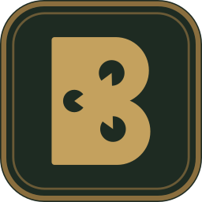

# Baryon's logo

[`baryon-logo.svg`](baryon-logo.svg) is Baryon's logo, chosen by the chief designer on 2026-11-21
([decision 0070](../decisions/0070-baryon-logo.md)).

## What it shows

A baryon is three quarks bound into one particle. The logo is a letter B with three round holes
cut in it, one in the stem and one in each bowl, the three quarks. Each hole is missing a wedge on
the side that faces the other two, so the three wedges line up into a triangle that is never drawn:
the eye joins the three quarks into one. The effect is the Kanizsa triangle, an illusion the
psychologist Gaetano Kanizsa described in 1955.

The B is brass (`#C4A15E`) on a dark forest-green tile (`#1E2B22`), inside a double brass frame
(`#8A6E3E`). The mark is drawn from circles, arcs and straight lines only, with no font, so it
needs no third-party license.

## Files

| File | What it is |
| --- | --- |
| [`baryon-logo.svg`](baryon-logo.svg) | The logo, on a 64-unit square; it scales to any size |
| [`../../editors/vscode/icons/baryon-file.svg`](../../editors/vscode/icons/baryon-file.svg) | The VS Code file icon: the logo without its inner hairline frame, which blurs at 16 pixels |
| [`../../editors/vscode/icons/baryon.png`](../../editors/vscode/icons/baryon.png) | The VS Code extension's icon: the logo at 128 by 128 pixels |

No trademark or similarity search has been done on the mark.
